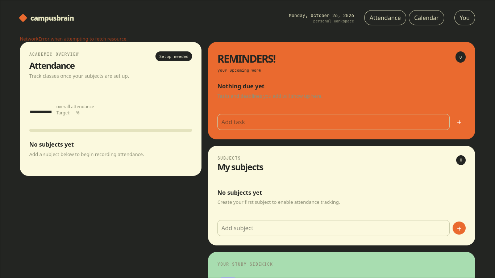
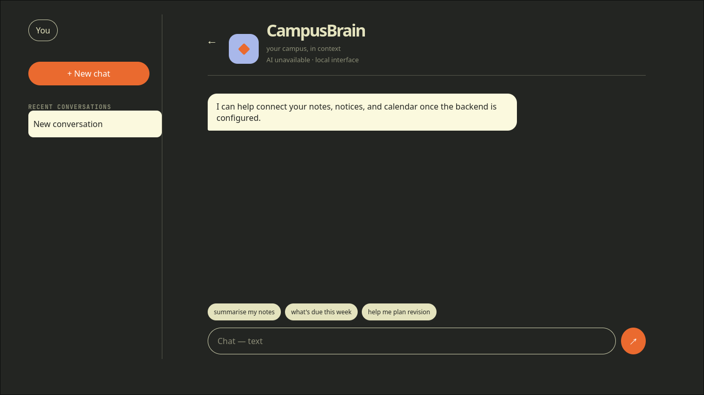
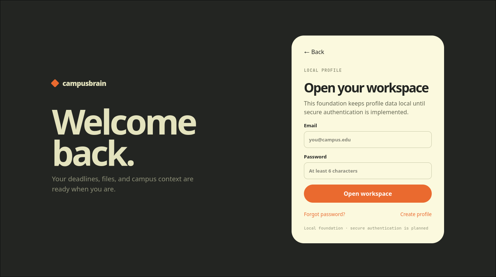
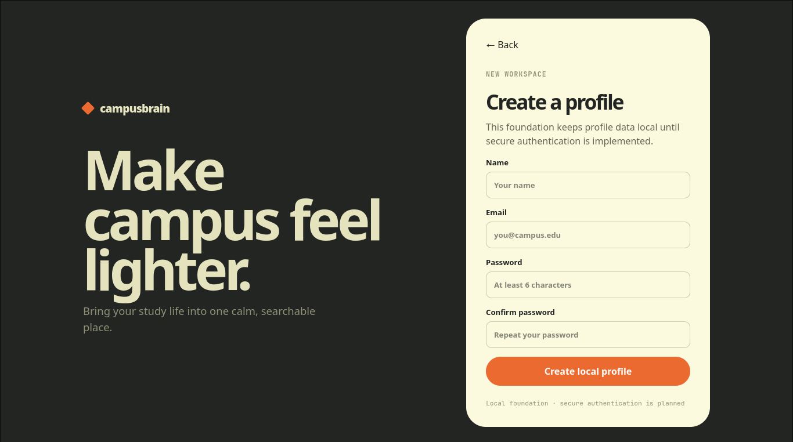

# 🎓 CampusBrain v0.1

**A Local-First Academic Operating System (React + FastAPI Scaffold)**

Built for the **Hacktoberfest 2026 Week 3 Challenge**.

---

## 💡 The Vision
EdTech platforms frequently silo student data into proprietary ecosystems. CampusBrain is an open-source, local-first academic operating system that gives students total control over their schedules, attendance tracking, and document querying without surrendering their data. 

## 🏗️ What is v0.1?
This repository contains the **Foundational Architecture** (Milestone 1) of CampusBrain. Before hooking up a database or API, I utilized AI coding agents to strictly separate concerns, establishing a modular React + TypeScript frontend and a validated FastAPI backend shell. 

This scaffold abandons "mock data" entirely. The UI correctly renders responsive, accessible components with **honest empty states** based on the current date, proving the frontend routing and component architecture are structurally sound and ready for backend integration.

## ✨ Implemented Features (Milestone 1)
* **Modular React + TS Frontend:** Clean component separation for Auth, Dashboard, Calendar, Chat, and Settings.
* **Responsive "Brutalist" UI:** Custom styling preserving a distinct palette, rounded panels, and mobile-friendly navigation.
* **FastAPI Backend Shell:** Configured Python backend featuring a validated `/health` endpoint to confirm API readiness.
* **Local-First Auth Flow:** UI foundation for localized profile creation and workspace access.

## 🛠️ Tech Stack
* **Frontend:** React, TypeScript, Vite
* **Backend:** Python, FastAPI
* **Architecture:** Modular Monorepo Scaffold

## ⚙️ Installation & Setup

**1. Clone the repository**
```bash
git clone [https://github.com/your-username/CampusBrain.git](https://github.com/your-username/CampusBrain.git)
cd CampusBrain
```
2. Run the Frontend
```Bash

cd frontend
npm install
npm run dev
```
3. Run the Backend (Health Check)
```Bash

cd backend
pip install fastapi uvicorn
uvicorn main:app --reload
```
🗺️ Roadmap (Milestone 2)

- Local SQLite persistence for subjects, attendance logs, and tasks.

- Integration of the PyMuPDF parser (from my Week 2 ScopeShield project) for academic notice ingestion.

- Gemma 4 open-weights API connection for the CampusBrain Chat interface.

## 📸 Screenshots

**The Executive Dashboard**

*The primary dashboard scaffold showing modular component blocks for Attendance, Reminders, and Subjects. Currently displaying honest empty states while the SQLite backend is finalized.*

**The Chat Interface**

*The dedicated 'Ask CampusBrain' chat workspace, featuring dynamic input fields and contextual quick-action pills.*

**Auth & Onboarding Flow**


*Local-first authentication foundation. User profiles remain isolated on the device until remote sync is implemented.*
